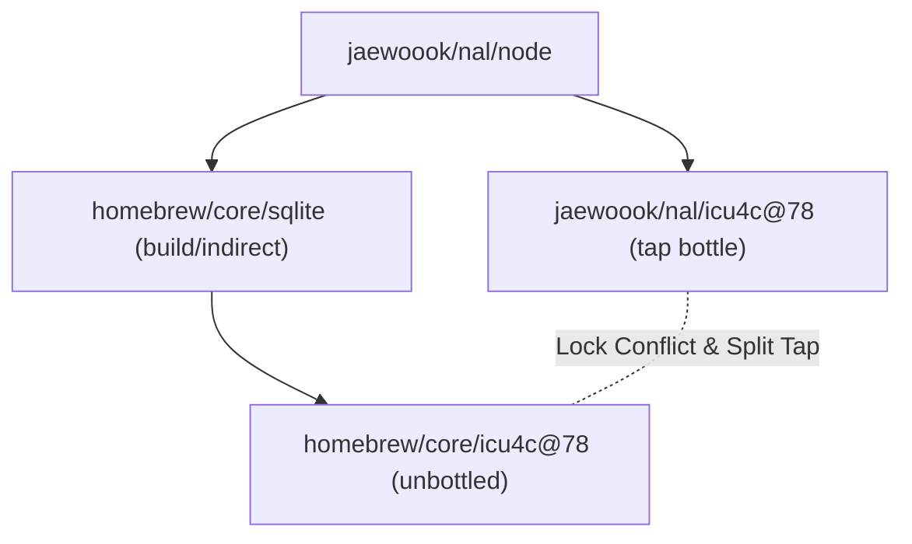
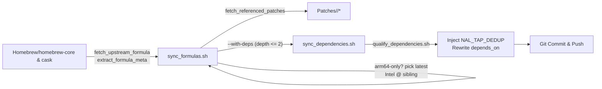
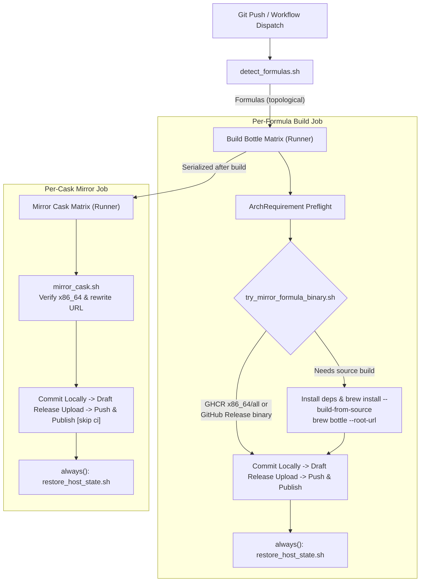

# Tap Architecture & Technical Design

This document details the internal architecture, design decisions, and edge-case mitigations implemented in `homebrew-nal`.

---

## 1. Tap & Homebrew Dependency Model

### The Split Tap / Diamond Dependency Problem

In a standard Homebrew installation, installing a tap formula that shares dependencies with formulas from `homebrew/core` exposes a fundamental limitation in Homebrew's dependency resolution:



1. **Lock Collisions (`OperationInProgressError`)**:
   Homebrew locks formula installations at the Cellar level: `/usr/local/Cellar/<formula>/<version>`. Because `Dependency` objects for `jaewoook/nal/foo` and `foo` have different `d.name` values, Homebrew's `Dependency.merge_repeats` (which groups strictly by `d.name`) does not recognize them as the same formula.
   When `FormulaInstaller#lock` calls `formula.recursive_dependencies`, both `jaewoook/nal/foo` and `foo` are returned. Locking the same Cellar directory twice in the same installation batch raises `OperationInProgressError: already locked /usr/local/Cellar/foo/...`.

2. **Cross-Tap Installation Duplicate Conflicts**:
   Even if locking succeeded, `FormulaInstaller#compute_dependencies` would attempt to install both the tap's prebuilt bottle and `homebrew/core`'s unbottled version from source, resulting in linking collisions and broken Superenv keg references.

---

### The Solution: `NAL_TAP_DEDUP` & In-Flight Tap Migration Hooks

Rather than requiring users or runners to modify the core Homebrew installation, tap formulas containing qualified dependencies dynamically inject lightweight, idempotent runtime hooks at formula load time:

```ruby
unless Dependency.singleton_class.const_defined?(:NAL_TAP_DEDUP)
  Dependency.singleton_class.prepend(Module.new do
    const_set(:NAL_TAP_DEDUP, true)
    def merge_repeats(all)
      all.group_by { |d| Utils.name_from_full_name(d.name) }.filter_map do |_, deps|
        pref = deps.find { |d| d.name.start_with?("jaewoook/nal/") } || deps.first
        pref&.class&.new(pref.name, merge_tags(deps), **(pref.uses_from_macos? ? { bounds: pref.bounds } : {}))
      end
    end
  end)

  begin
    require "tab"
    Tab.singleton_class.prepend(Module.new do
      def for_keg(keg)
        tab = super
        remaps = Thread.current[:nal_tap_remaps]
        if remaps && !remaps.empty?
          keg_path = keg.to_s.chomp("/")
          real_keg = begin
            File.realpath(keg_path)
          rescue SystemCallError
            keg_path
          end
          target_tap = remaps[File.dirname(keg_path)] || remaps[File.dirname(real_keg)]
          if target_tap && tab&.source.is_a?(Hash) && tab.source["tap"] == "homebrew/core"
            remapped = tab.dup
            remapped.source = tab.source.merge("tap" => target_tap.to_s)
            remapped.tap = target_tap if remapped.respond_to?(:tap=)
            tab = remapped
          end
        end
        tab
      end
    end)

    require "formula_installer"
    FormulaInstaller.prepend(Module.new do
      def install_dependency(dep, dep_formula = dep.to_formula)
        if dep_formula.tap&.to_s == "jaewoook/nal"
          prev_remaps = Thread.current[:nal_tap_remaps] || {}
          rack_str = dep_formula.rack.to_s.chomp("/")
          rack_keys = [rack_str]
          begin
            rack_keys << File.realpath(rack_str)
          rescue SystemCallError
          end
          remaps = prev_remaps.dup
          rack_keys.uniq.each { |k| remaps[k] = dep_formula.tap }
          Thread.current[:nal_tap_remaps] = remaps
          begin
            super
          ensure
            Thread.current[:nal_tap_remaps] = prev_remaps
          end
        else
          super
        end
      end
    end)
  rescue LoadError
  end
end
```

#### How it Works:
1. **Dependency Deduplication (`merge_repeats`)**:
   - **Grouping by Short Name**: Replaces exact full-name grouping with `Utils.name_from_full_name(d.name)` (e.g. `jaewoook/nal/icu4c@78` and `icu4c@78` group to `icu4c@78`).
   - **Tap Priority**: If a group contains a tap-qualified dependency (`jaewoook/nal/*`), it is selected over the unqualified core dependency, ensuring prebuilt bottles are poured.
   - **Global Compatibility**: Feeds both `formula.recursive_dependencies` (used by `FormulaInstaller#lock`) and `FormulaInstaller#compute_dependencies` (used by `install_dependencies`), eliminating `OperationInProgressError` lock collisions.

2. **Zero-Uninstall Cross-Tap Migration (`Tab.for_keg` + `FormulaInstaller#install_dependency`)**:
   - **The Upstream Guard**: Homebrew's `formula_installer.rb` checks `dep_formula.tap.to_s != tab_tap.to_s` on existing keg receipts read via `Keg#tab` → `Tab.for_keg(keg)` and aborts with `Error: <dep> is already installed from homebrew/core! Please brew uninstall <dep> first.` whenever an upgraded dependency changes tap origin.
   - **Scoped In-Flight `Tab.for_keg` Remapping**: While `FormulaInstaller#install_dependency` executes `super` for a `jaewoook/nal` dependency, `Thread.current[:nal_tap_remaps]` maps that dependency's Cellar rack path to `dep_formula.tap`. The `Tab.for_keg` wrapper intercepts `INSTALL_RECEIPT.json` reads under that rack and returns a duplicated `Tab` with `source["tap"]` remapped from `homebrew/core` to `jaewoook/nal` (without mutating cached `Tab` objects on failure).
   - **Seamless Bottle Pour**: Homebrew safely bypasses the abort, unlinks the old core keg, pours the tap's prebuilt x86_64 bottle, and writes the new tap receipt without requiring manual `brew uninstall` commands from the end-user.
   - **Idempotency**: Guarded by `const_defined?(:NAL_TAP_DEDUP)` so multiple formula loads in the same Ruby process evaluate safely without overhead or redefinition warnings.

---

### Runtime vs. Build/Test Scoping

`scripts/qualify_dependencies.sh` enforces strict boundaries when qualifying dependencies:

| Dependency Type | Syntax Example | Qualified to `jaewoook/nal/*`? | Rationale |
| :--- | :--- | :--- | :--- |
| **Runtime Dependency** | `depends_on "libuv"` | **Yes** | Client Macs require prebuilt binary bottles for runtime libraries to avoid source builds. |
| **Build Dependency** | `depends_on "cmake" => :build` | **No** | Build tools run temporarily during compilation and do not need tap bottle distribution. |
| **Test Dependency** | `depends_on "pytest" => :test` | **No** | Test harnesses run only during `brew test`. |
| **Combined Build/Test** | `depends_on "pkgconf" => [:build, :test]` | **No** | Treated as non-runtime; delegates directly to core. |
| **Linux / ARM Blocks** | `on_linux do ... end` / `on_arm do ... end` | **No** | Tap targets macOS Intel (`x86_64`); Linux-only and ARM-only dependency blocks are left unqualified and skipped during dependency resolution. |

---

## 2. Upstream Synchronization Engine

The upstream sync pipeline runs on a monthly schedule (`sync-upstream.yml`) or on-demand (`workflow_dispatch`):



### Upstream Formula Sharding Resolution
`Homebrew/homebrew-core` shards formulas across subdirectories:
- `Formula/<first-letter>/<name>.rb` (standard)
- `Formula/lib/<name>.rb` (for `lib*` packages, e.g. `libffi`, `libnghttp2`, `libuv`)

`fetch_upstream_formula` in [`scripts/formula_helpers.sh`](scripts/formula_helpers.sh) (shared by [`scripts/sync_formulas.sh`](scripts/sync_formulas.sh) and [`scripts/sync_dependencies.sh`](scripts/sync_dependencies.sh)) dynamically probes:
```bash
https://raw.githubusercontent.com/Homebrew/homebrew-core/master/Formula/lib/${dep}.rb
https://raw.githubusercontent.com/Homebrew/homebrew-core/master/Formula/${first_char}/${dep}.rb
https://raw.githubusercontent.com/Homebrew/homebrew-core/master/Formula/${dep}.rb
```
Formulas are sanitized (stripping `no_autobump!`) and saved into the tap's flat `Formula/<name>.rb` structure.

### Intel (`x86_64`) Compatibility Policy & Versioned Fallback
When upstream drops Intel macOS support for an unversioned formula (`depends_on arch: :arm64` outside `on_linux`/`on_arm` blocks and with no `on_intel` alternative):
1. `extract_formula_meta` in [`scripts/formula_helpers.sh`](scripts/formula_helpers.sh) flags the formula as `arm64_only=true`.
2. For unversioned formulas (e.g. `openjdk`), `list_versioned_candidates` discovers upstream `<formula>@<ver>` siblings via the Homebrew Formulae API (`versioned_formulae`), local directories (`file://` test upstreams), or the GitHub Contents API, sorted newest-first by numeric version tuple.
3. [`scripts/sync_formulas.sh`](scripts/sync_formulas.sh) selects the newest sibling that supports Intel `x86_64` (e.g. `openjdk@25`), syncs it as `Formula/<formula>@<ver>.rb`, and tracks it in `.formula-versions.json`.
4. If an explicitly versioned formula (`<formula>@<ver>`) is `:arm64`-only or no Intel-compatible variant exists, it is skipped cleanly without committing an unbuildable formula.

### Formula Metadata Extraction & Patch Synchronization
- **Block-Scoped Version Parsing (`extract_formula_meta`)**: Parses `version`, `revision`, and `url` only at the formula/class/`stable` level, ignoring `head`, `bottle`, `livecheck`, `resource`, `fails_with`, `patch`, `test`, `on_linux`, `on_arm`, `caveats`, `service`, and `def` blocks. Supports `.tar.*`, `.tgz`, `.tbz2`, `.txz`, `.zip`, `.pem`, `-sources`, tag paths, and git `tag:` URLs, preventing nested directives (such as `fails_with :gcc do version "11"`) or `"unknown"` entries from poisoning `.formula-versions.json`.
- **Referenced Patch Downloads (`fetch_referenced_patches`)**: Both [`scripts/sync_formulas.sh`](scripts/sync_formulas.sh) and [`scripts/sync_dependencies.sh`](scripts/sync_dependencies.sh) scan outside `on_linux`/`on_arm` blocks and comments for `Patches/<pkg>/<file>` references, validate paths against traversal outside `Patches/`, download atomically via temporary files, fail fast on download errors, and stage `Patches/` in both formula and dependency registration commits.
- **Diamond Dependency Visited-Depth Tracking**: [`scripts/sync_dependencies.sh`](scripts/sync_dependencies.sh) resolves runtime dependencies up to `MAX_DEPTH=2`, tracks minimum visited depth per dependency in a Bash 3.2-compatible temp index so diamond dependencies are not re-processed, and preserves valid existing entries in `.formula-versions.json`.

### Automated Major Version Preservation & Cask Sync
- **Major Version Auto-Preservation**: When an unversioned formula advances its major (or `major.minor`) version (e.g. `node` 24 → 26), [`scripts/sync_formulas.sh`](scripts/sync_formulas.sh) retrieves the previous Intel-compatible `<formula>@<prev_version>.rb` sibling (along with any referenced `Patches/`), qualifies its tap dependencies, and records it with `is_versioned: true` in `.formula-versions.json`.
- **Formula & Cask Synchronization Scope**: Unparameterized/scheduled runs of [`scripts/sync_formulas.sh`](scripts/sync_formulas.sh) check the default formula scope (`llvm gcc` — pass explicit formula names to sync others) alongside the union of `.cask-versions.json` keys and `Casks/*.rb` filenames from `Homebrew/homebrew-cask`, recording versions and SHA256 digests in `.formula-versions.json` and `.cask-versions.json`.

---

## 3. CI/CD Build, Mirror & Release Pipeline

The bottle and Cask pipeline (`build.yml`) runs across three stages:



### Detection, Rebuild Skipping & Topological Sort
- **Incremental Build Detection (`detect_formulas.sh`)**: On `push` events, inspects changed `Formula/*.rb`, `Patches/<name>/*`, and `Casks/*.rb`. Already-bottled formulas (matching `root_url "https://github.com/Jaewoook/homebrew-nal/releases/download/...`) are skipped unless a file under literal prefix `Patches/<name>/` was modified; already-mirrored Casks are likewise skipped.
- **Topological Dependency Sort**: Parses `depends_on` declarations among queued formulas and sorts them via recursive DFS post-order so dependencies build and publish their bottles before dependents (`max-parallel: 1`), and `mirror-cask` is serialized after `build` (`needs: [detect, build]`) so shared self-hosted runners never contend on `/usr/local`, `/opt/homebrew`, or git pushes.

### Architecture Preflight & Fast-Path Binary Mirroring
1. **Architecture Preflight ([`scripts/build_bottle.sh`](scripts/build_bottle.sh))**: Evaluates `ArchRequirement` on `jaewoook/nal/<formula>` immediately after resolving the version so any `:arm64`-only formula fails fast before installing dependencies.
2. **Fast-Path A — Upstream GHCR Bottle Mirroring ([`scripts/try_mirror_formula_binary.sh`](scripts/try_mirror_formula_binary.sh))**: Eligible when a formula has no `jaewoook/nal/*` tap dependencies and no custom `patch`/`Patches/<name>` (and `FORCE_SOURCE_BUILD != true`). Queries `formulae.brew.sh/api/formula/<name>.json` for the matching version/revision, selects an upstream bottle tag by priority (`x86_64_<host>`/`<host>` → older backward-compatible macOS generations → `all`, excluding newer macOS generations so e.g. Sequoia falls back to source build instead of mirroring a Tahoe bottle), downloads from `ghcr.io`, verifies SHA256, and writes the `bottle do` block at class scope using bracket/block depth tracking.
3. **Fast-Path B — Standalone GitHub Release Binary Repackaging**: When no upstream GHCR bottle exists and the formula has no macOS runtime dependencies (ignoring `:build`, `:test`, `[:build, :test]`, `:macos`, `:xcode`, and `on_linux`/`on_arm` blocks), checks the upstream GitHub release for macOS `x86_64`/`amd64`/`x64`/`universal` archives, verifies the archive contains a single clean standalone Mach-O `x86_64` executable (rejecting `.dylib`/`.so` shared libraries, `lib/`/`libexec/`/`share/` runtime subdirectories, and extra scripts/assets), stages it into `"$("$BREW_BIN" --cellar)/<formula>/<version>"` with a `Tab` receipt, and packages a bottle via `brew bottle`.
4. **Source Build Fallback & Keg Adoption**: Installs dependencies via `--only-dependencies`, adopts a matching Cellar keg if already built (otherwise compiles via `--build-from-source --skip-post-install --skip-link`), marks `built_as_bottle = true`, runs `brew bottle --root-url`, and normalizes double-hyphen tarball filenames (`<name>--` → `<name>-`).
5. **`HOMEBREW_NO_INSTALLED_DEPENDENTS_CHECK="1"`**: Prevents Homebrew from failing builds due to unrelated deprecated core formulas or Tier 3 warnings on the runner host.

### Cask Mirroring & Verification
[`scripts/mirror_cask.sh`](scripts/mirror_cask.sh) validates that a Cask does not require `:arm64` without an `on_intel` block, extracts Intel `version`/`url`/`sha256` (using indentation-anchored `on_intel`/`on_arm` matching), downloads and verifies SHA256, inspects extracted `.zip`/tarball or mounted `.dmg` (`hdiutil` + `lipo`) contents for Mach-O `x86_64` slices, and rewrites `Casks/<name>.rb` (stripping upstream `url` kwargs such as `verified:`) to point to tag `cask-<name>.<version>`. [`scripts/commit_cask.sh`](scripts/commit_cask.sh) commits with `[skip ci]` in the commit body to avoid re-triggering `build.yml`.

### Host State Preservation & Restoration
On Apple Silicon build hosts that maintain both `/opt/homebrew` (`arm64`) and `/usr/local` (Rosetta `x86_64`), [`scripts/restore_host_state.sh`](scripts/restore_host_state.sh) records pre-job `/opt/homebrew` (and Intel cask) install state (`record-state`) and runs on `if: always()` (`restore`) to uninstall temporary `/usr/local` builds, run `brew autoremove`, and reinstall or remove formulas in `/opt/homebrew` with sanitized non-interactive ARM64 environment variables (`env -u CMAKE_APPLE_SILICON_PROCESSOR`, `HOMEBREW_NO_AUTO_UPDATE=1`, `HOMEBREW_NO_ASK=1`, `NONINTERACTIVE=1`, and `/opt/homebrew/bin` in `PATH`), skipping `/opt/homebrew` cask reinstalls when the cask was untouched in `/usr/local`.

---

## 4. Runner Security & Committer Lifecycle

Self-hosted runners build formulas/casks, upload release assets before updating `main`, and push bottle/cask commits cleanly.

### Ephemeral Bot Git Identity, Signing & Two-Phase Release Publishing
To avoid committing with the runner's personal system identity, leaving bot credentials in `.git/config`, or pointing `main` to missing assets:
1. [`scripts/commit_bottle.sh`](scripts/commit_bottle.sh) and [`scripts/commit_cask.sh`](scripts/commit_cask.sh) delegate to `git_bot_commit_and_push` in [`scripts/formula_helpers.sh`](scripts/formula_helpers.sh), passing `-c` identity overrides using `BOT_NAME` / `BOT_EMAIL` (defaulting to `NAL Bot <nal-git-system@jaewook.me>`).
2. **GPG Signing with Explicit Opt-Out**: `BOT_GPG_KEY` defaults to `024D4017DFF5360A` (`${BOT_GPG_KEY-024D4017DFF5360A}`); if non-empty and present in the host's GPG keyring, `-c commit.gpgsign=true` is applied. Setting `BOT_GPG_KEY=""` (or omitting the key from the keyring) cleanly disables signing without error.
3. **Subshell Isolation & Safe Rebase/Retry**: Git operations run inside an isolated subshell so caller `EXIT`/`INT`/`TERM` traps and env vars are preserved, rebase conflicts cleanly `git rebase --abort` instead of leaving `rebase-merge/`, and concurrent push races retry up to 3 times.
4. **Two-Phase Release Upload (`build.yml`)**: `commit_bottle.sh`/`commit_cask.sh` commit locally (`BOT_NO_PUSH=true`), `softprops/action-gh-release@v3` uploads the archive to a draft release first (or existing published release on rebuilds), and only then does `git_bot_push_main` push `main` and publish the draft release against the pushed SHA (`gh release edit --draft=false`).

---

## 5. Summary Matrix of Tap Scripts

| Script | Responsibility | Key Flags / Environment Variables |
| :--- | :--- | :--- |
| [`scripts/formula_helpers.sh`](scripts/formula_helpers.sh) | Shared upstream formula fetching, `versioned_formulae` discovery, block-scoped metadata/arch parsing, SHA256, `Patches/` downloads, bottle archive normalization, and bot git commit/push helpers. | Sourced by `sync_formulas.sh`, `sync_dependencies.sh`, `detect_formulas.sh`, `build_bottle.sh`, `try_mirror_formula_binary.sh`, `mirror_cask.sh`, `commit_bottle.sh`, `commit_cask.sh`, and `restore_host_state.sh` |
| [`scripts/detect_formulas.sh`](scripts/detect_formulas.sh) | Identifies formulas/casks needing build or mirroring, skips already-published artifacts unless `Patches/<name>/` changed, and sorts formulas topologically. | `FORMULA_INPUT`, `CASK_INPUT`, `EVENT_NAME`, `EVENT_BEFORE`, `GITHUB_OUTPUT` |
| [`scripts/sync_formulas.sh`](scripts/sync_formulas.sh) | Syncs formulas and casks from upstream, selects latest Intel-compatible fallback for `:arm64`-only formulas, preserves major versions, downloads `Patches/`, and updates state JSON. | `[formulas...]`, `--casks`, `--with-deps`, `--force`, `--dry-run`, `--commit`, `--push`, `--no-gpg-sign`, `--no-preserve` |
| [`scripts/sync_dependencies.sh`](scripts/sync_dependencies.sh) | Recursively resolves runtime dependencies (depth ≤ 2), fetches missing formulas and `Patches/`, repairs missing/corrupt state entries, and triggers qualification. | `--formula-dir`, `--patches-dir`, `--state-file`, `--upstream-base`, `--upstream-api-base`, `--max-depth` |
| [`scripts/qualify_dependencies.sh`](scripts/qualify_dependencies.sh) | Rewrites non-Linux/non-ARM runtime `depends_on` references to `jaewoook/nal/*` and injects the `NAL_TAP_DEDUP` runtime hook. | `--formula-dir`, `--tap`, `[formulas...]` |
| [`scripts/build_bottle.sh`](scripts/build_bottle.sh) | Runs `ArchRequirement` preflight, attempts fast-path binary mirroring, builds/bottles from source under `x86_64`, and normalizes bottle filenames. | `<formula>`, `FORCE_SOURCE_BUILD`, `SKIP_HOST_RESTORE` |
| [`scripts/try_mirror_formula_binary.sh`](scripts/try_mirror_formula_binary.sh) | Mirrors upstream GHCR `x86_64`/`all` bottles (Fast-Path A) or repackages standalone GitHub Release macOS `x86_64` binaries (Fast-Path B). | `<formula> [--dry-run] [<version>]` |
| [`scripts/commit_bottle.sh`](scripts/commit_bottle.sh) | Commits updated bottle blocks (`[skip ci]`), rebases, and pushes to `main` with ephemeral bot identity and optional GPG signing. | `<formula>`, `BOT_NAME`, `BOT_EMAIL`, `BOT_GPG_KEY` |
| [`scripts/mirror_cask.sh`](scripts/mirror_cask.sh) | Validates Intel `x86_64` support, verifies SHA256 and Mach-O slices, and rewrites Cask URLs/checksums to GitHub Releases. | `<cask>`, `SKIP_ARCH_BINARY_MOUNT`, `SKIP_HOST_RESTORE` |
| [`scripts/commit_cask.sh`](scripts/commit_cask.sh) | Commits mirrored Cask definitions (`[skip ci]` in body), rebases, and pushes to `main`. | `<cask> [<version>]`, `BOT_NAME`, `BOT_EMAIL`, `BOT_GPG_KEY` |
| [`scripts/restore_host_state.sh`](scripts/restore_host_state.sh) | Snapshots `/opt/homebrew` installation state before builds and cleans `/usr/local` while restoring `/opt/homebrew` afterward. | `<record-state\|restore> <formula\|cask> <name>` |
