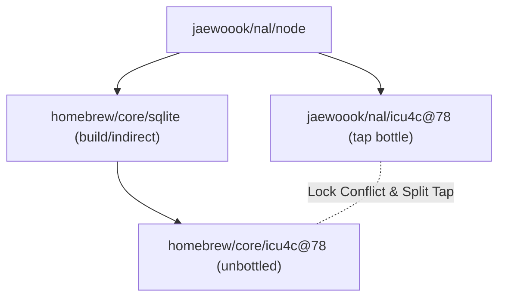
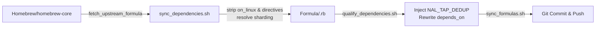
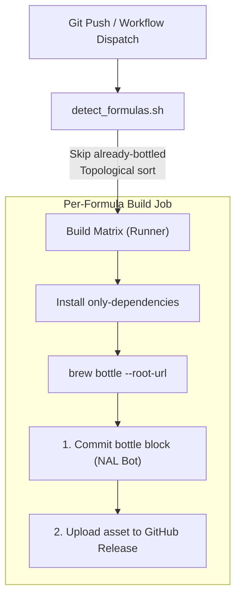

# Tap Architecture & Technical Design

This document details the internal architecture, design decisions, and edge-case mitigations implemented in `homebrew-nal`.

---

## 1. Tap & Homebrew Dependency Model

### The Split Tap / Diamond Dependency Problem

In a standard Homebrew installation, installing a tap formula that shares dependencies with formulas from `homebrew/core` exposes a fundamental limitation in Homebrew's dependency resolution:



1. **Lock Collisions (`OperationInProgressError`)**:
   Homebrew locks formula installations at the Cellar level: `/usr/local/Cellar/<formula>/<version>`. Because `Dependency` objects for `jaewoook/nal/foo` and `foo` have different `d.name` values, Homebrew's `Dependency.merge_repeats` (which groups strictly by `d.name`) does not recognize them as the same formula.
   When `FormulaInstaller#lock` calls `formula.recursive_dependencies`, both `jaewoook/nal/foo` and `foo` are returned. Locking the same Cellar directory twice in the same installation batch raises `OperationInProgressError: already locked /usr/local/Cellar/foo/...`.

2. **Cross-Tap Installation Duplicate Conflicts**:
   Even if locking succeeded, `FormulaInstaller#compute_dependencies` would attempt to install both the tap's prebuilt bottle and `homebrew/core`'s unbottled version from source, resulting in linking collisions and broken Superenv keg references.

---

### The Solution: `NAL_TAP_DEDUP` Runtime Hook

Rather than requiring users or runners to modify the core Homebrew installation, tap formulas containing qualified dependencies dynamically inject a lightweight, idempotent runtime hook at formula load time:

```ruby
unless defined?(NAL_TAP_DEDUP)
  NAL_TAP_DEDUP = true
  Homebrew::CLI::NamedArgs if false
  module NALDependencyDedup
    def merge_repeats(deps)
      grouped = deps.group_by { |d| Utils.name_from_full_name(d.name) }
      grouped.map do |_short_name, group|
        tap_dep = group.find { |d| d.name.start_with?("jaewoook/nal/") }
        tap_dep || super(group).first
      end.compact
    end
  end
  Dependency.singleton_class.prepend(NALDependencyDedup)
end
```

#### How it Works:
- **Grouping by Short Name**: Replaces exact full-name grouping with `Utils.name_from_full_name(d.name)` (e.g. `jaewoook/nal/icu4c@78` and `icu4c@78` group to `icu4c@78`).
- **Tap Priority**: If a group contains a tap-qualified dependency (`jaewoook/nal/*`), it is selected over the unqualified core dependency, ensuring prebuilt bottles are poured.
- **Idempotency**: Guarded by `unless defined?(NAL_TAP_DEDUP)` so multiple formula loads in the same Ruby process evaluate safely without overhead or redefinition warnings.
- **Global Compatibility**: Feeds both `formula.recursive_dependencies` (used by `FormulaInstaller#lock`) and `FormulaInstaller#compute_dependencies` (used by `install_dependencies`), working reliably on both self-hosted runners and standard client Macs running unpatched Homebrew.

---

### Runtime vs. Build/Test Scoping

`scripts/qualify_dependencies.sh` enforces strict boundaries when qualifying dependencies:

| Dependency Type | Syntax Example | Qualified to `jaewoook/nal/*`? | Rationale |
| :--- | :--- | :--- | :--- |
| **Runtime Dependency** | `depends_on "libuv"` | **Yes** | Client Macs require prebuilt binary bottles for runtime libraries to avoid source builds. |
| **Build Dependency** | `depends_on "cmake" => :build` | **No** | Build tools run temporarily during compilation and do not need tap bottle distribution. |
| **Test Dependency** | `depends_on "pytest" => :test` | **No** | Test harnesses run only during `brew test`. |
| **Combined Build/Test** | `depends_on "pkgconf" => [:build, :test]` | **No** | Treated as non-runtime; delegates directly to core. |
| **Linux-Only Blocks** | `on_linux do depends_on "..." end` | **No** | Tap targets macOS Intel (`x86_64`); Linux blocks are stripped or left unqualified. |

---

## 2. Upstream Synchronization Engine

The upstream sync pipeline runs on a monthly schedule (`sync-upstream.yml`) or on-demand:



### Upstream Formula Sharding Resolution
`Homebrew/homebrew-core` shards formulas across subdirectories:
- `Formula/<first-letter>/<name>.rb` (standard)
- `Formula/lib/<name>.rb` (for `lib*` packages, e.g. `libffi`, `libnghttp2`, `libuv`)

`scripts/sync_dependencies.sh` dynamically probes:
```bash
https://raw.githubusercontent.com/Homebrew/homebrew-core/HEAD/Formula/lib/${dep}.rb
https://raw.githubusercontent.com/Homebrew/homebrew-core/HEAD/Formula/${first_char}/${dep}.rb
https://raw.githubusercontent.com/Homebrew/homebrew-core/HEAD/Formula/${dep}.rb
```
Formulas are saved into the tap's flat `Formula/<name>.rb` structure.

### Automated Major Version Preservation
When an unversioned formula advances its major version (e.g. `node` 24 → 26):
1. `sync_formulas.sh` compares the new major version against `.formula-versions.json`.
2. The previous major version formula (`Formula/<name>@<prev_version>.rb`) is retrieved and added to the tap.
3. This ensures client workflows targeting `@<major>` continue to resolve while the latest unversioned formula advances.

---

## 3. CI/CD Build & Bottle Pipeline

The bottle build workflow (`build.yml`) operates across two matrix tiers:



### Incremental Build Detection & Rebuild Skipping
On `push` events, `scripts/detect_formulas.sh` inspects whether a formula already has an existing `root_url` block matching `https://github.com/Jaewoook/homebrew-nal/releases/download/<tag>`.
- If the bottle block exists and no custom patch files in `Patches/<formula>/` were modified, the formula is **skipped**.
- This prevents redundant multi-hour rebuilds of massive packages (like `llvm`, `gcc`, or `node`) when only tap dependencies, scripts, or unrelated formulas are updated.

### Topological Dependency Sort
If multiple unbottled formulas are queued in the same push:
1. `detect_formulas.sh` parses `depends_on "jaewoook/nal/<dep>"` declarations.
2. Formulas are sorted in topological order using Kahn's algorithm so dependencies (e.g. `libuv`, `icu4c@78`) build and publish their bottles before dependents (`node`).

### Keg Adoption & Suppressing Deprecation Checks
- **Existing Keg Adoption**: If a matching version is already installed in `/usr/local/Cellar`, the build script packages the existing keg directly via `brew bottle`, bypassing source recompilation.
- **`HOMEBREW_NO_INSTALLED_DEPENDENTS_CHECK="1"`**: Homebrew normally runs linkage and dependency health checks on all installed kegs. On Intel macOS Sequoia, this would fail due to deprecated upstream bottles or unrelated core formulas. Setting this variable restricts checks to the active formula.

---

## 4. Runner Security & Committer Lifecycle

Self-hosted runners build formulas and commit updated bottle blocks back to the repository.

### Ephemeral Bot Git Identity & Optional Signing
To avoid committing with the runner's personal system identity or leaving automated bot credentials globally configured:
1. Runner scripts record previous `user.name`, `user.email`, `user.signingkey`, and `commit.gpgsign` settings.
2. The runner configures an isolated commit identity (`BOT_NAME` and `BOT_EMAIL`, defaulting to `NAL Bot <nal-git-system@jaewook.me>`).
3. **Optional GPG Signing**: If a GPG key ID is provided via `BOT_GPG_KEY` and exists in the host's keyring, `commit.gpgsign = true` is applied; otherwise, commits proceed unsigned without blocking the build.
4. A Bash `trap` ensures that when the job exits (on success, error, or cancellation), all git settings are restored to their previous states.

---

## 5. Summary Matrix of Tap Scripts

| Script | Responsibility | Key Flags / Arguments |
| :--- | :--- | :--- |
| [`scripts/detect_formulas.sh`](file:///Users/jaewookahn/repos/homebrew-nal/scripts/detect_formulas.sh) | Identifies formulas needing builds, applies bottle skip logic, and sorts topologically. | `--event <event_name>` |
| [`scripts/sync_formulas.sh`](file:///Users/jaewookahn/repos/homebrew-nal/scripts/sync_formulas.sh) | Synchronizes formulas from upstream, sanitizes DSL, and updates `.formula-versions.json`. | `[formulas...]`, `--with-deps`, `--dry-run`, `--commit` |
| [`scripts/sync_dependencies.sh`](file:///Users/jaewookahn/repos/homebrew-nal/scripts/sync_dependencies.sh) | Discovers and fetches upstream runtime dependencies, resolving sharded paths. | `[formulas...]` |
| [`scripts/qualify_dependencies.sh`](file:///Users/jaewookahn/repos/homebrew-nal/scripts/qualify_dependencies.sh) | Rewrites runtime dependencies to tap namespace and injects the `NAL_TAP_DEDUP` hook. | `[formulas...]` |
| [`scripts/build_bottle.sh`](file:///Users/jaewookahn/repos/homebrew-nal/scripts/build_bottle.sh) | Handles dependency installation, compilation, bottle packaging, and bottle block generation. | `<formula>` |
