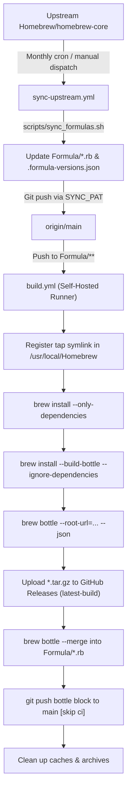

# homebrew-nal

A custom [Homebrew](https://brew.sh/) tap providing automated syncing and prebuilt binary bottles for heavy compiler toolchains (**LLVM**, **GCC**) on macOS Intel (`x86_64`).

---

## Background & Motivation

According to the official [Homebrew Support Tiers](https://docs.brew.sh/Support-Tiers) documentation:
- **Tier 3 Classification**: macOS on Intel (`x86_64`) is classified as a Tier 3 configuration ("CI coverage is unavailable; bottles will rarely be built or published").
- **Discontinued Intel Bottles**: In alignment with Apple phasing out Intel hardware, Homebrew has stopped building new bottles for Intel systems, and plans to remove support for running Homebrew on Intel in or after September 2027. While existing bottles may still work, updated formulae build from source.

Without prebuilt bottles, running `brew install` for massive compiler suites like LLVM or GCC on Intel Macs forces Homebrew to compile entirely from source. This process takes several hours, requires tens of gigabytes of disk space, and frequently fails due to unbottled dependency chains.

This tap solves that problem by:
1. **Syncing Formulas**: Tracking upstream `Homebrew/homebrew-core` for version updates via an automated monthly schedule.
2. **Automated Prebuilding**: Compiling native `x86_64` binaries on a self-hosted runner (M-series Mac running Intel Homebrew via Rosetta 2).
3. **Hosting Bottles**: Publishing bottle archives (`.tar.gz`) directly to GitHub Releases.
4. **Injecting Bottle Blocks**: Merging bottle SHA-256 blocks back into formula definitions so clients can install prebuilt binaries immediately without local compilation.

---

## Client Usage

To install formulas from this tap on any Intel Mac (or Apple Silicon Mac running Rosetta):

```bash
# Tap the repository
brew tap jaewoook/nal

# Install prebuilt formulas (specify full tap path to avoid falling back to upstream)
brew install jaewoook/nal/llvm
brew install jaewoook/nal/gcc
```

---

## Architecture & Workflow Sequence



### 1. Formula Synchronization (`.github/workflows/sync-upstream.yml`)
- **Trigger**: Runs on a schedule on the 1st of every month at 18:00 UTC (`0 18 1 * *`), or manually via `workflow_dispatch`.
- **Action**: Executes [`scripts/sync_formulas.sh`](scripts/sync_formulas.sh), which checks the Homebrew Formula API (`formulae.brew.sh`), compares versions against [`.formula-versions.json`](.formula-versions.json), downloads the latest `.rb` definition, preserves tap metadata, and commits changes.
- **Authentication**: Uses a repository secret `SYNC_PAT` so pushes to `main` trigger downstream workflows.

### 2. Bottle Build & Release (`.github/workflows/build.yml`)
- **Trigger**: Pushes modifying `Formula/**` or manual `workflow_dispatch`.
- **Runner**: Runs on a self-hosted macOS runner with Intel Homebrew (`/usr/local/bin/brew`).
- **Steps**:
  1. Symlinks the checkout directory to `$(brew --repository)/Library/Taps/jaewoook/homebrew-nal`.
  2. Resolves and installs build dependencies (`brew install --only-dependencies`).
  3. Builds formulas for bottling (`brew install --build-bottle --ignore-dependencies`) to bypass upstream unbottled-dependency errors on Intel macOS.
  4. Generates bottle packages and metadata (`brew bottle --json`).
  5. Uploads `*.tar.gz` binaries to GitHub Releases under tag `latest-build`.
  6. Merges updated bottle checksums into formula files (`brew bottle --merge --write`).
  7. Commits the bottle block to `main` with `[skip ci]`.
  8. Cleans up build artifacts and prunes Homebrew caches.

---

## Manual Setup Guide

### 1. Build Environment Setup

1. **System & Storage Requirements**:
   - An Apple Silicon (M-series) or Intel Mac running macOS 14+ (Sonoma or Sequoia).
   - At least **20 GB of free disk space** on the builder machine (compiling LLVM or GCC requires substantial temporary storage for intermediate object files).

2. **Rosetta 2** (if using an Apple Silicon Mac as the build host):
   ```bash
   /usr/sbin/softwareupdate --install-rosetta --agree-to-license
   ```

3. **Intel Homebrew Installation**:
   Install Homebrew into `/usr/local` (the Intel prefix) under Rosetta:
   ```bash
   arch -x86_64 /bin/bash -c "$(curl -fsSL https://raw.githubusercontent.com/Homebrew/install/HEAD/install.sh)"
   ```
   Verify that `/usr/local/bin/brew` is functional:
   ```bash
   /usr/local/bin/brew config
   ```

4. **Command Line Tools (CLT)**:
   ```bash
   xcode-select --install
   ```

> [!IMPORTANT]
> **Outdated Xcode Incompatibility**:
> If an older version of Xcode exists at `/Applications/Xcode.app` (e.g., Xcode 14 on macOS 15 Sequoia), Homebrew detects it via Spotlight metadata and refuses to build packages from source. Because Command Line Tools provide all needed compilers, either remove the obsolete app or hide it by stripping `.app` and appending `.noindex`:
> ```bash
> sudo rm -rf /Applications/Xcode.app
> # Or retain the files safely without Spotlight indexing:
> sudo mv /Applications/Xcode.app /Applications/Xcode.noindex
> ```

---

### 2. Configure GitHub Repository & Secrets

#### Workflow Permissions Setting
To allow the build workflow (`build.yml`) to commit updated formula bottle blocks and publish GitHub Releases:
1. In your repository on GitHub, go to **Settings → Actions → General**.
2. Scroll to **Workflow permissions**.
3. Select **Read and write permissions**.
4. Check **Allow GitHub Actions to create and approve pull requests**.
5. Click **Save**.

#### Personal Access Token (`SYNC_PAT`)
GitHub Actions blocks pushes made by the default `GITHUB_TOKEN` from triggering other workflows. To ensure that `sync-upstream.yml` pushes trigger `build.yml`, a Personal Access Token (PAT) is required:

##### Option A: Fine-Grained Personal Access Token (Recommended)
1. Go to your GitHub account **Settings → Developer Settings → Personal access tokens → Fine-grained tokens**.
2. Click **Generate new token**.
3. Under **Repository access**, select **Only select repositories** and pick `homebrew-nal`.
4. Under **Permissions → Repository permissions**, configure:
   - **Contents**: `Read and write` (allows committing updated formula files)
5. Generate and copy the token.

##### Option B: Personal Access Token (Classic)
1. Go to your GitHub account **Settings → Developer Settings → Personal access tokens → Tokens (classic)**.
2. Click **Generate new token (classic)**.
3. Select the following scope:
   - `public_repo` (or `repo` for private repositories)
4. Generate and copy the token.

##### Adding the Secret to the Repository
1. In this repository, navigate to **Settings → Secrets and variables → Actions**.
2. Click **New repository secret**.
3. Set **Name** to `SYNC_PAT` and paste your token value into **Secret**.

---

### 3. Self-Hosted Runner Notes

For general installation, follow the official GitHub documentation on [Adding self-hosted runners](https://docs.github.com/en/actions/hosting-your-own-runners/managing-self-hosted-runners/adding-self-hosted-runners).

**macOS Service Notes**:
- On modern macOS (Ventura, Sonoma, Sequoia), GitHub's `./svc.sh start` uses `launchctl load`, which registers the LaunchAgent without actively spawning the runner process. To ensure the runner process is actively running:
  ```bash
  SVC_LABEL=$(basename ~/Library/LaunchAgents/actions.runner.*.plist .plist)
  launchctl kickstart -kp "gui/$(id -u)/$SVC_LABEL"
  ```
- To verify the runner is active and listening:
  ```bash
  tail -f ~/Library/Logs/actions.runner.*/stdout.log
  ```
- Because LaunchAgents require an active user graphical session, enable **Automatic Login** in **System Settings → Users & Groups** and disable system sleep (`sudo pmset -a disablesleep 1`) so the runner stays online after reboots.

---

## Local Script Usage

You can run the formula synchronization script manually at any time:

```bash
# Check upstream versions without changing files (dry-run)
./scripts/sync_formulas.sh --dry-run

# Sync specific formulas
./scripts/sync_formulas.sh llvm gcc

# Force sync and commit changes locally
./scripts/sync_formulas.sh --force --commit

# Sync, commit, and push directly to main
./scripts/sync_formulas.sh --commit --push
```

### Script Options

| Flag | Long Option | Description |
|---|---|---|
| `-f` | `--formulas LIST` | Formulas to check (default: `llvm gcc`) |
| | `--force` | Force update even if versions match |
| `-d` | `--dry-run` | Inspect upstream without writing files |
| `-c` | `--commit` | Automatically commit updated formulas |
| `-p` | `--push` | Push commits to the remote branch |
| `-b` | `--branch` | Target branch (default: `main`) |

---

## License

This repository and tap scripts are licensed under the MIT License. Individual formulas and upstream code retain their respective upstream licenses.
