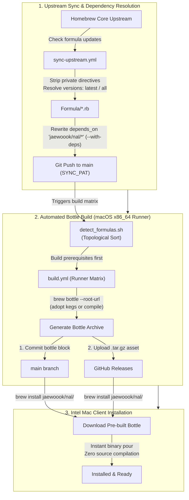

# homebrew-nal

A custom [Homebrew](https://brew.sh/) tap providing automated upstream syncing and prebuilt binary bottles for macOS Intel (`x86_64`) on macOS Sequoia (15).

---

## Background & Motivation

According to the official [Homebrew Support Tiers](https://docs.brew.sh/Support-Tiers) documentation:
- **Tier 3 Classification**: macOS on Intel (`x86_64`) is classified as a Tier 3 configuration ("CI coverage is unavailable; bottles will rarely be built or published").
- **Discontinued Intel Bottles**: In alignment with Apple phasing out Intel hardware, Homebrew has stopped building new bottles for Intel systems, and plans to remove support for running Homebrew on Intel in or after September 2027. While existing bottles may still work, updated formulae build from source.

Without prebuilt bottles, running `brew install` for massive compiler suites (LLVM, GCC) or developer utilities on Intel Macs forces Homebrew to compile entirely from source. This process takes hours, consumes tens of gigabytes of disk space, and frequently fails due to missing build dependencies in Superenv.

This tap solves that problem by:
1. **Syncing Formulas**: Tracking upstream `Homebrew/homebrew-core` for version updates via an automated monthly schedule or manual dispatch.
2. **Sanitizing Tap Formulas**: Automatically stripping official-tap-only DSL directives (such as `no_autobump!`) to keep custom tap loading clean.
3. **Resolving & Qualifying Dependencies**: Automatically importing runtime dependencies and rewriting unqualified dependencies (`depends_on "foo"`) to tap-qualified declarations (`depends_on "jaewoook/nal/foo"`), ensuring Intel Macs pour prebuilt binary bottles for the full dependency tree rather than building unbottled core dependencies from source.
4. **Topological Prebuilding**: Sorting build queues so prerequisite dependencies are bottled before dependents on a dedicated self-hosted macOS runner.
5. **Publishing Bottles**: Hosting bottle archives on GitHub Releases and committing bottle blocks back to formulas for instant installation.

---

## Client Usage

```bash
# Tap the repository
brew tap jaewoook/nal

# Install latest version (default)
brew install jaewoook/nal/<formula>
# Examples:
#   brew install jaewoook/nal/node      # Installs latest Node (e.g. 26.x)
#   brew install jaewoook/nal/rust      # Installs latest Rust (e.g. 1.99.x)
#   brew install jaewoook/nal/llvm      # Installs latest LLVM (e.g. 23.x)

# Install specific versioned formula
brew install jaewoook/nal/<formula>@<version>
# Examples:
#   brew install jaewoook/nal/node@22   # Installs Node 22 LTS
#   brew install jaewoook/nal/llvm@18   # Installs LLVM 18
#   brew install jaewoook/nal/python@3.14
```

> [!TIP]
> **Switching from `homebrew/core`**:
> If a formula was previously installed from `homebrew/core`, Homebrew disallows installing the same formula name from another tap simultaneously. To switch to this tap's prebuilt version:
> ```bash
> brew uninstall <formula>
> brew install jaewoook/nal/<formula>
> # Or directly switch taps:
> brew reinstall jaewoook/nal/<formula>
> ```

---

## Multiple Version Support

Formulas in `homebrew-nal` support both the latest release (default) and major versioned releases:

| Target | Description | Example |
| :--- | :--- | :--- |
| **`latest` (default)** | Resolves to the main formula file (`Formula/<name>.rb`). | `node`, `llvm`, `gcc`, `rust` |
| **Specific Version** | Targets a dedicated versioned formula (`Formula/<name>@<ver>.rb`). | `node@22`, `node@20`, `llvm@18` |
| **`all` Versions** | Syncs/builds the latest version plus all active versioned formulas discovered via Homebrew Core API. | `node:all`, `llvm:all` |

---

## Workflow Architecture



### 1. Upstream Synchronization (`sync-upstream.yml`)
- Runs on a monthly cron schedule or manual dispatch.
- Downloads updated formula files from `Homebrew/homebrew-core`.
- Strips official-tap-only DSL directives (e.g. `no_autobump!`) and records version state in [`.formula-versions.json`](.formula-versions.json).
- **Opt-in Dependency Sync (`with_deps`)**: When enabled, automatically discovers runtime dependencies, imports missing formulas into `Formula/`, marks them with `"is_dependency": true`, and rewrites references to `depends_on "jaewoook/nal/<dep>"`.
- Pushes commits to `main` using `SYNC_PAT` so downstream build workflows are triggered automatically.

### 2. Bottle Build & Release Pipeline (`build.yml`)
- Triggered by pushes to `Formula/**` or manual dispatch.
- **Topological Matrix Ordering**: Uses `scripts/detect_formulas.sh` to sort target formulas so dependencies build and release before their dependents.
- **Runner Auto-Trust & Keg Adoption**: Ensures tap and formula trust (`brew trust`) on modern Homebrew, and reuses matching Cellar kegs for instant bottle packaging without recompilation.
- **Commit First, Release Second**: Merges and pushes the bottle block to `main` first, then attaches the GitHub Release asset directly to the resulting commit SHA. This ensures release tags always point directly to their respective bottle block commits.

---

## Host & Runner Requirements

### 1. Build Environment Setup

1. **System & Architecture**:
   - macOS 15 (Sequoia) on Intel (`x86_64`) or Apple Silicon running Intel Homebrew under Rosetta 2 (`arch -x86_64`).
   - At least **20 GB of free disk space** for intermediate compiler build objects.

2. **Intel Homebrew Installation**:
   ```bash
   arch -x86_64 /bin/bash -c "$(curl -fsSL https://raw.githubusercontent.com/Homebrew/install/HEAD/install.sh)"
   ```

3. **Developer Tools**:
   - **Command Line Tools (CLT)**: Sufficient for all standard CLI formulas (`xcode-select --install`).
   - **Full Xcode (Xcode 16+)**: Required only for formulas building native macOS Cocoa GUI bundles (such as `pinentry-mac`) that depend on Interface Builder (`ibtool`):
     ```bash
     sudo xcode-select -s /Applications/Xcode.app/Contents/Developer
     sudo xcodebuild -license accept
     ```

---

### 2. GitHub Repository & Secrets Setup

- **Workflow Permissions**: In **Settings → Actions → General**, set Workflow permissions to **Read and write permissions** and allow creating pull requests.
- **Personal Access Token (`SYNC_PAT`)**: GitHub Actions blocks pushes by the default `GITHUB_TOKEN` from triggering other workflows. Generate a fine-grained PAT (or classic token with `public_repo` scope) with `Contents: Read and write`, and add it as a repository secret named `SYNC_PAT`.

---

### 3. Self-Hosted Runner Notes

- On modern macOS, start the runner LaunchAgent with:
  ```bash
  SVC_LABEL=$(basename ~/Library/LaunchAgents/actions.runner.*.plist .plist)
  launchctl kickstart -kp "gui/$(id -u)/$SVC_LABEL"
  ```
- Enable **Automatic Login** in **System Settings → Users & Groups** and disable system sleep (`sudo pmset -a disablesleep 1`) so the builder stays online across reboots.

---

## Local Script Usage

```bash
# Check upstream versions without making changes (dry-run)
./scripts/sync_formulas.sh --dry-run

# Sync specific formulas (default: latest version)
./scripts/sync_formulas.sh llvm gcc

# Sync all supported versions for a formula (latest + all versioned formulas)
./scripts/sync_formulas.sh --versions all node

# Sync specific major versions for a formula
./scripts/sync_formulas.sh --versions 20,22 node
# Or pass versioned formula names directly:
./scripts/sync_formulas.sh node@22 llvm@18

# Sync formula and automatically register its runtime dependencies
./scripts/sync_formulas.sh --with-deps node

# Register specific formulas explicitly as dependencies
./scripts/sync_formulas.sh --as-dependency c-ares libuv

# Resolve and download runtime dependencies for local formulas
./scripts/sync_dependencies.sh node

# Re-qualify tap dependencies (depends_on "foo" -> depends_on "jaewoook/nal/foo")
./scripts/qualify_dependencies.sh

# Force sync and commit changes locally
./scripts/sync_formulas.sh --force --commit

# Sync, commit, and push directly to main
./scripts/sync_formulas.sh --commit --push
```

---

## License

This repository and tap scripts are licensed under the MIT License. Individual formulas and upstream code retain their respective upstream licenses.
