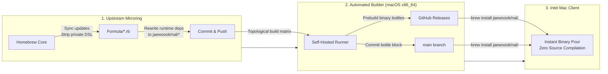

# homebrew-nal

A custom [Homebrew](https://brew.sh/) tap providing automated upstream syncing and prebuilt binary bottles for macOS Intel (`x86_64`) on macOS Sequoia (15).

---

## Background & Motivation

According to the official [Homebrew Support Tiers](https://docs.brew.sh/Support-Tiers) documentation:
- **Tier 3 Classification**: macOS on Intel (`x86_64`) is classified as Tier 3 ("CI coverage is unavailable; bottles will rarely be built or published").
- **Discontinued Intel Bottles**: In alignment with Apple phasing out Intel hardware, Homebrew has stopped publishing new binary bottles for Intel Macs, forcing formulae to compile from source.

Without prebuilt bottles, running `brew install` for massive developer packages (LLVM, GCC, Node, Rust) compiles entirely from source. This process takes hours, consumes tens of gigabytes of disk space, and frequently fails due to missing build dependencies in Superenv.

**`homebrew-nal`** solves this by maintaining a dedicated self-hosted macOS Intel builder that continuously mirrors upstream `homebrew-core`, packages prebuilt binary bottles, and pours them instantly on your Mac with **zero source compilation**.

---

## Client Usage

### 1. Tap the Repository
```bash
brew tap jaewoook/nal
```

### 2. Install Packages
Install latest version:
```bash
brew install jaewoook/nal/<formula>
```
*Examples:*
```bash
brew install jaewoook/nal/node      # Installs latest Node
brew install jaewoook/nal/rust      # Installs latest Rust
brew install jaewoook/nal/llvm      # Installs latest LLVM
```

### 3. Install Specific Versions
You can directly target major versioned releases:
```bash
brew install jaewoook/nal/<formula>@<version>
```
*Examples:*
```bash
brew install jaewoook/nal/node@22   # Installs Node 22 LTS
brew install jaewoook/nal/llvm@18   # Installs LLVM 18
brew install jaewoook/nal/python@3.14
```

> [!NOTE]
> **Major Version Auto-Preservation**:
> When an unversioned formula advances its major version upstream (e.g. Node 24 → 26), previous versions are automatically preserved as `<formula>@<prev_version>` (e.g. `node@24`), ensuring your existing workflows continue to install reliably.

---

## Switching from `homebrew/core`

If a package was previously installed from `homebrew/core`, Homebrew prevents installing the same formula name from another tap simultaneously. To switch to `homebrew-nal`'s prebuilt bottle:

```bash
# Directly switch to the tap's bottle:
brew reinstall jaewoook/nal/<formula>

# Or cleanly uninstall from core first:
brew uninstall <formula>
brew install jaewoook/nal/<formula>
```

---

## Client FAQ & Troubleshooting

<details>
<summary><b>Q: Does this replace or modify my Homebrew installation?</b></summary>

No. `homebrew-nal` is a standard Homebrew tap. It operates cleanly inside your existing Homebrew prefix (`/usr/local`) without requiring any system modifications or patched Homebrew binaries.
</details>

<details>
<summary><b>Q: Why does Homebrew display an Intel x86_64 deprecation warning during installation?</b></summary>

Upstream Homebrew 4.x displays a notice warning that macOS Intel support is Tier 3 and bottles are no longer provided by Homebrew maintainers. This is an informational notice from Homebrew core. `homebrew-nal` exists specifically to provide the bottles that upstream discontinued.
</details>

<details>
<summary><b>Q: How do I verify a bottle was poured instead of compiling from source?</b></summary>

When installing, Homebrew prints:
```text
==> Pouring <formula>--<version>.sequoia.bottle.tar.gz
```
You can also run `brew info jaewoook/nal/<formula>` to see the installed bottle tag.
</details>

---

## How It Works



---

## Project Documentation

- **[ARCHITECTURE.md](ARCHITECTURE.md)**: Deep dive into the internal design, including dynamic diamond dependency deduplication (`NAL_TAP_DEDUP`), AST dependency qualification, topological sorting, and Homebrew Cellar locking mechanics.
- **[HOST_SETUP.md](HOST_SETUP.md)**: Guide for setting up the self-hosted macOS Intel builder, configuring GitHub Actions secrets (`SYNC_PAT`), managing runner services, optional bot committer & GPG signing, and running local maintenance scripts.

---

## License

This project and its tap scripts are licensed under the [MIT License](LICENSE). Individual formulas and upstream packages retain their respective upstream licenses.
